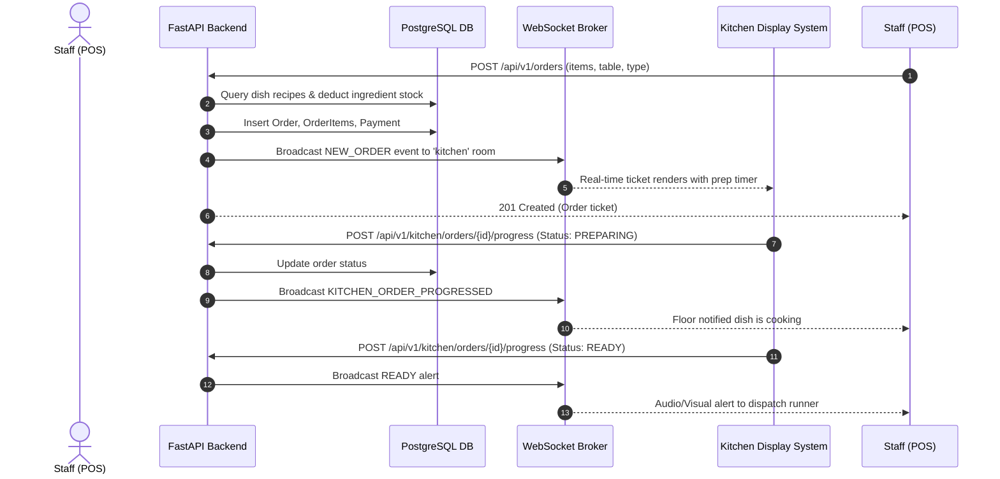

# System Architecture & Technical Specifications

RestaurantIQ is engineered as a modular, enterprise-grade multi-tier SaaS platform designed for high availability, transactional consistency, and data-driven decision support.

---

## 1. Architectural Layers

### 1. Presentation Layer (Frontend)
- **Framework**: React 18 with TypeScript.
- **Routing**: React Router v6 with declarative ProtectedRoute component enforcing authentication tokens and RBAC role checks.
- **Styling**: Tailwind CSS with dark slate theme, custom responsive scrollbars, and accessible high-contrast color palettes.
- **Visualizations**: Recharts for rendering area charts, multi-series confidence bands, and distribution bar charts.
- **State & Context**: Context API for decoupled domain stores:
  - `AuthContext`: session tokens, user identity, role checking.
  - `BranchContext`: multi-branch switcher and persistent active branch state.
- **Real-Time Layer**: WebSocket connection for instantaneous Kitchen Display System updates and notification alerts.

### 2. Application & API Layer (Backend)
- **Framework**: FastAPI (Python 3.11).
- **Dependency Injection**: Modular FastAPI dependencies for database sessions (`get_db`), JWT token extraction (`get_current_user`), and role-based access enforcement (`require_roles`).
- **Data Validation**: Pydantic v2 schemas providing strict compile-time and runtime validation with automatic OpenAPI specification generation.
- **WebSocket Hub**: `ConnectionManager` class supporting channel/room-based pub/sub broadcasting (`kitchen`, `notifications`).

### 3. Business & Service Layer
- **POS & Orders Service**: Calculates multi-item subtotal, dynamic branch tax, discounts, assigns table statuses, and dispatches to kitchen.
- **Recipe & Inventory Service**: Automatically explodes dish orders into raw ingredient requirements and writes audit transactions to the inventory ledger.
- **Kitchen KDS Service**: Manages elapsed prep counters, delayed alerts, and single-click lifecycle progression.
- **Procurement Service**: Tracks purchase orders and automatically updates raw inventory on receipt.

### 4. Artificial Intelligence & Machine Learning Layer
- **Demand Forecaster**: Gradient Boosting Regressor trained on chronological daily sales with temporal, cyclic, and lag features.
- **Replenishment Optimizer**: Linear supply-chain inventory model incorporating safety buffers and supplier lead time consumption.
- **Anomaly Detector**: Isolation Forest unsupervised outlier model scanning revenue fluctuations and scrap waste volumes.
- **Customer Segmenter**: RFM metric calculation with K-Means clustering ($k=4$).
- **Sentiment Analyzer**: Aspect-based NLP analyzer parsing review text into polarity and departmental aspect scores.
- **Grounded AI Assistant**: Semantic intent classifier and SQL query generator producing factual answers with underlying data tables.

### 5. Persistence Layer (Database)
- **Database**: PostgreSQL 16 (production) with SQLAlchemy 2.0 ORM.
- **Migrations**: Alembic for version-controlled, reproducible schema migrations.
- **Dual-Mode Portability**: Compatible with SQLite for zero-setup local development and automated pytest test suites.

---

## 2. Real-Time Order Lifecycle Sequence

---

## 3. Security & Compliance
- **Cryptographic Security**: Passwords hashed using Bcrypt with automatic salt generation.
- **Token Specifications**: Signed HMAC-SHA256 JWT tokens with configurable expiration and separate refresh token lifecycles.
- **SQL Injection Prevention**: All queries parameterized via SQLAlchemy 2.0 ORM.
- **Audit Logging**: Immutable `audit_logs` table tracking user ID, IP address, action, and target entity metadata.
