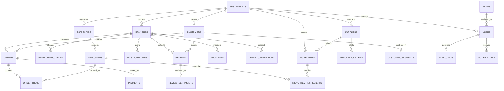

# Database Schema & Entity Design

RestaurantIQ uses a normalized relational database schema implemented in PostgreSQL 16 using SQLAlchemy 2.0 ORM and Alembic migrations.

---

## 1. Entity-Relationship Diagram (ERD)



---

## 2. Entity Dictionary & Field Specifications

### Core Administrative Entities
- `roles`: `id` (PK), `name` (unique: super_admin, owner, manager, chef, staff), `description`.
- `permissions`: `id` (PK), `name` (unique), `description`.
- `role_permissions`: bridge table linking `role_id` and `permission_id`.
- `users`: `id` (PK), `email` (unique index), `hashed_password`, `full_name`, `phone`, `role_id` (FK), `restaurant_id` (FK), `branch_id` (FK), `is_active`, `is_superuser`, timestamps.
- `audit_logs`: `id` (PK), `user_id` (FK), `action`, `resource_type`, `resource_id`, `details_json`, `ip_address`, `created_at` (index).

### Multi-Branch Operations
- `restaurants`: `id` (PK), `name`, `description`, `address`, `phone`, `email`, `currency` (default: `$`), `tax_rate` (default: 5.0%), timestamps.
- `branches`: `id` (PK), `restaurant_id` (FK), `name`, `code` (unique index), `address`, `city`, `state`, `postal_code`, `phone`, `opening_time`, `closing_time`, `is_active`, `created_at`.
- `restaurant_tables`: `id` (PK), `branch_id` (FK), `table_number`, `capacity`, `status` (AVAILABLE, OCCUPIED, RESERVED, DIRTY).

### Menu & Recipe Architecture
- `categories`: `id` (PK), `restaurant_id` (FK), `name`, `description`, `icon`, `display_order`, `is_active`.
- `menu_items`: `id` (PK), `category_id` (FK), `name` (index), `description`, `price`, `cost_price`, `preparation_time_minutes`, `image_url`, `is_available`, `is_vegetarian`, `calories`, timestamps.
- `ingredients`: `id` (PK), `restaurant_id` (FK), `name`, `unit` (kg, g, liters, ml, units), `current_stock`, `minimum_stock`, `maximum_stock`, `cost_per_unit`, `supplier_id` (FK), `expiry_date`, timestamps.
- `menu_item_ingredients`: Recipe bridge table: `id` (PK), `menu_item_id` (FK), `ingredient_id` (FK), `quantity_required`, `unit`.

### Procurement & Supply Chain
- `suppliers`: `id` (PK), `restaurant_id` (FK), `name`, `contact_person`, `email`, `phone`, `address`, `lead_time_days`, `rating`, `created_at`.
- `inventory_transactions`: `id` (PK), `ingredient_id` (FK), `branch_id` (FK), `transaction_type` (PURCHASE, USAGE, WASTE, ADJUSTMENT), `quantity`, `unit_cost`, `reference_id`, `notes`, `created_at`.
- `purchase_orders`: `id` (PK), `branch_id` (FK), `supplier_id` (FK), `order_number` (unique index), `status` (DRAFT, ORDERED, RECEIVED, CANCELLED), `total_amount`, `expected_delivery_date`, `received_date`, `notes`, `created_at`.
- `purchase_order_items`: `id` (PK), `purchase_order_id` (FK), `ingredient_id` (FK), `quantity_ordered`, `quantity_received`, `unit_price`.

### POS, Orders & Payments
- `customers`: `id` (PK), `restaurant_id` (FK), `name`, `email` (unique index), `phone` (index), `total_spent`, `total_orders`, `last_visit_date`, `loyalty_points`, `created_at`.
- `orders`: `id` (PK), `branch_id` (FK), `customer_id` (FK), `table_id` (FK), `order_number` (unique index), `order_type` (DINE_IN, TAKEAWAY, DELIVERY), `status` (NEW, CONFIRMED, PREPARING, READY, SERVED, COMPLETED, CANCELLED), `subtotal`, `tax`, `discount`, `total_amount`, `notes`, timestamps, `completed_at`.
- `order_items`: `id` (PK), `order_id` (FK), `menu_item_id` (FK), `quantity`, `unit_price`, `subtotal`, `special_instructions`, `status`.
- `payments`: `id` (PK), `order_id` (FK, unique), `payment_method` (CASH, CARD, UPI, ONLINE), `amount`, `status` (PENDING, COMPLETED, REFUNDED), `transaction_id`, `created_at`.

### AI, Machine Learning & Feedback
- `demand_predictions`: `id` (PK), `branch_id` (FK), `menu_item_id` (FK), `forecast_date` (index), `predicted_quantity`, `confidence_lower`, `confidence_upper`, `model_name`, `mae_score`, `created_at`.
- `customer_segments`: `id` (PK), `customer_id` (FK, unique), `segment_name`, `cluster_id`, `rfm_recency`, `rfm_frequency`, `rfm_monetary`, `updated_at`.
- `anomalies`: `id` (PK), `branch_id` (FK), `metric_name`, `anomaly_date` (index), `severity` (LOW, MEDIUM, HIGH), `anomaly_score`, `expected_value`, `actual_value`, `explanation`, `is_resolved`, `created_at`.
- `ai_insights`: `id` (PK), `branch_id` (FK), `category`, `title`, `insight_text`, `recommended_action`, `impact_level`, `created_at`.
- `reviews`: `id` (PK), `branch_id` (FK), `customer_id` (FK), `rating`, `comment`, `source`, `review_date` (index), `created_at`.
- `review_sentiments`: `id` (PK), `review_id` (FK, unique), `sentiment_label` (POSITIVE, NEUTRAL, NEGATIVE), `polarity_score`, `aspect_food`, `aspect_service`, `aspect_price`, `aspect_ambience`, `aspect_delivery`, `keywords_json`, `created_at`.
- `waste_records`: `id` (PK), `branch_id` (FK), `menu_item_id` (FK), `ingredient_id` (FK), `waste_type`, `quantity`, `unit`, `estimated_cost`, `reason`, `recorded_by_id` (FK), `waste_date` (index), `notes`, `created_at`.

---

## 3. Database Migration Procedures

Run migrations using Alembic:
```bash
# Generate new migration when models change
alembic revision --autogenerate -m "Add_new_column"

# Apply pending migrations
alembic upgrade head

# Rollback one migration
alembic downgrade -1
```
